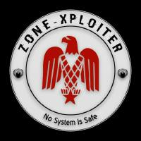
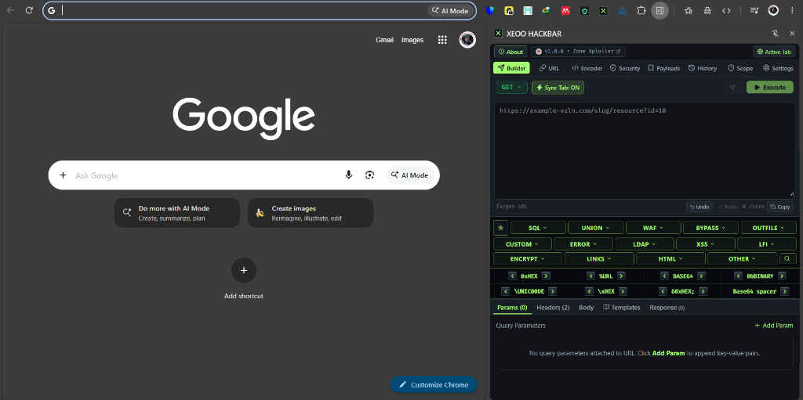

<p align="center">
  
</p>

<h1 align="center">🛡️ XEOO HACKBAR (v1.0.0)</h1>

<p align="center">
  <strong>Next-Generation Web Security Testing & HTTP Inspection for Chrome</strong>
</p>

<p align="center">
  <em>Perlindungan evaluasi keamanan dan pengujian penetrasi web tingkat lanjut — berjalan langsung di Side Panel Chrome dengan arsitektur 100% lokal, cepat, dan aman.</em>
</p>

<p align="center">
  <a href="LICENSE"></a>
  <a href="#"></a>
  <a href="#"></a>
  <a href="#"></a>
  <a href="PRIVACY.md"></a>
</p>

<p align="center">
  <a href="#-preview">📸 Preview</a> •
  <a href="#-fitur-utama">✨ Fitur Utama</a> •
  <a href="#-apa-yang-baru-di-v100">🚀 Apa yang Baru di v1.0.0</a> •
  <a href="#️-arsitektur">🛠️ Arsitektur</a> •
  <a href="#-instalasi">📦 Instalasi</a> •
  <a href="#-penggunaan">💬 Penggunaan</a> •
  <a href="PRIVACY.md">🔒 Privasi</a> •
  <a href="https://github.com/notbell1/xeoo-hackbar/issues">🐛 Lapor Bug</a> •
  <a href="LICENSE">📄 Lisensi</a>
</p>

<hr />

## 📸 Preview

<p align="center">
  
</p>

---

## ✨ Fitur Utama

### 1. HTTP Request Builder & URL Precision Parser
- **Method Lengkap**: Mendukung `GET`, `POST`, `PUT`, `PATCH`, `DELETE`, `HEAD`, `OPTIONS`.
- **Sinkronisasi Tab Aktif (*Active Tab Sync*)**: Terhubung langsung dengan tab browser yang sedang dibuka (`Sync Tab: ON/OFF`).
- **Pembedah Parameter URL**: Memisahkan protokol, host, port, path, parameter kueri, dan hash secara visual dengan pembaruan dua arah tanpa risiko korupsi karakter.
- **Dukungan Tipe Body**: Raw text, JSON (dengan tombol format), dan `application/x-www-form-urlencoded`.

### 2. Security Template Library (170+ Payload Teruji)
Tersusun rapi dalam 14 kategori utama dan puluhan subkategori terstruktur:
- **SQL Basic**: Auth bypass, Boolean blind, Time blind, Stacked queries, klausa SQL, dan pemisah komentar.
- **Union-Based & WAF-Based**: Cakupan penuh untuk MySQL, PostgreSQL, dan Microsoft SQL Server.
- **DIOS (Dump In One Shot)**:
  - 100% tervalidasi secara sintaks dan delimiter komentar.
  - Bebas dari slot kosong atau placeholder (`SOON !!`).
  - Ekstraksi skema `information_schema`, internal tabel `sys.schema`, dan tabel mesin `innodb_index_stats`.
  - Varian WAF bypass: Version comments (`/*!50000...*/`), inline comments (`/**/`), substitusi spasi (`%0a`, `%09`, `%0c`, `%0d`), dan URL/HTML hex.
- **Custom Signature & Watermarking Generator**:
  - Generator tanda tangan hex dinamis dengan author default **`ZXMarchia`**.
  - Pilihan tema warna: **Neon Green Glow (`#A3FF70`)**, **Neon Red Fire (`#FF3344`)**, **Cyber Cyan (`#00FFFF`)**, **Electric Gold (`#FFE600`)**, dan **ASCII Frame**.
- **Modul Keamanan Khusus**: XSS, LFI/Path Traversal, LDAP/Fuzzing, Out-File, Custom Based, HTML Container, dan Link referensi keamanan.

### 3. Quick Conversion Bar (Adaptive 3D Cyber Bevel)
- Tombol konversi instan untuk teks yang dipilih atau seluruh input:
  - `0xHEX` (String literal heksadesimal)
  - `%URL` (Standard & full hex URL encoding)
  - `BASE64` (Encode & decode Base64)
  - `0bBINARY` (Representasi biner 8-bit)
  - `\UNIC00DE` (Escape sequence unicode `\uXXXX`)
  - `\xHEX` (C-style hex encoding)
  - `&#xHEX;` (Entitas HTML hex)
  - `Base64 spacer`
- **Tata Letak Responsif**: Menggunakan `ResizeObserver` untuk otomatis turun menjadi 2 baris (layar < 780px) atau 4 baris (layar < 390px) tanpa tombol terpotong.

### 4. Payloads & Test Vector Repository
- Pustaka bawaan 31 vektor uji standar (SQLi, XSS, LFI, RCE, SSRF, SSTI, XXE, Open Redirect).
- Navigasi strip kategori dengan tombol panah `<` `>`, dukungan mouse wheel horizontal, pencarian instan, dan penanda favorit.
- Ekspor dan impor data kustom dalam format JSON.

### 5. Multi-Format Encoder / Decoder Workbench
Workbench mandiri untuk transformasi data simultan:
- URL Decode / Encode (Component & RFC 3986 Full Hex)
- Base64 Encode / Decode
- Hexadecimal & ASCII
- Entitas HTML (Named & Numeric)
- Hashing Kriptografis MD5 & SHA-256

### 6. Defensive Security & Response Inspector
- **Audit Response Security Headers**: Menilai kepatuhan CSP, HSTS, X-Frame-Options, X-Content-Type-Options, Referrer-Policy, dan Permissions-Policy.
- **Pendeteksi Kebocoran Versi**: Memperingatkan jika header `Server` atau `X-Powered-By` mengekspos versi perangkat lunak target.
- **Pendeteksi Firewall (WAF)**: Mendeteksi pola blokir Cloudflare, ModSecurity, AWS WAF, dan Akamai beserta rekomendasi bypass.
- **Tab Respons**: Tampilan Pretty, Raw, dan Headers dengan kalkulator waktu dan ukuran body.

### 7. History, Evidence & Scope Guardian
- **Penyimpanan Lokal Terenkripsi**: Menggunakan IndexedDB (Dexie v4) yang tersimpan 100% di browser lokal Anda.
- **Redaksi Kredensial Otomatis**: Menghapus token `Authorization`, cookie sesi (`Cookie`, `Set-Cookie`), dan `API keys` sebelum disimpan ke log.
- **Laporan Bukti**: Ekspor log permintaan satu-klik ke format Markdown (`.md`) dan JSON.
- **Scope Guardian**: Memblokir permintaan ke jaringan internal/localhost secara default untuk mencegah serangan DNS rebinding.

---

## 🚀 Apa yang Baru di v1.0.0

- ⚡ **Rilis Awal Berbasis Manifest V3 Side Panel**: Performa ultra-cepat dan hemat memori.
- 🎨 **Redesain Antarmuka Cyberpunk Dark**: Tombol bevel 3D retro dengan aksen hijau neon `#A3FF70`.
- 🛡️ **Integrasi Modul DIOS Terlengkap**: 170+ template DIOS tanpa slot kosong, dilengkapi generator watermark author `ZXMarchia`.
- 🔍 **Suite Audit Sintaks Otomatis**: Verifikasi integritas tanda kurung dan delimiter komentar pada seluruh payload.
- 📱 **Navigasi Kategori Responsif**: Penambahan tombol scroll geser dan mouse-wheel pada bilah kategori.
- 📜 **Sinkronisasi Dokumen Lengkap**: Penyelarasan penuh antara README, Security, Privacy, Disclaimer, dan Changelog.

---

## 🛠️ Arsitektur & Tech Stack

| Komponen | Teknologi |
| :--- | :--- |
| **Platform Ekstensi** | Google Chrome Desktop (Manifest V3 Side Panel API) |
| **Framework UI** | React 18.3 (Strict Mode) |
| **Bahasa Pemrograman** | TypeScript 5.7 (Strict Type Checking) |
| **Styling** | Tailwind CSS v4 |
| **State Management** | Zustand v5 |
| **Database Lokal** | Dexie.js v4 (IndexedDB) |
| **Ikon Antarmuka** | Lucide React |
| **Build Tooling** | Vite v6 |
| **Testing Engine** | Vitest v3 |

Untuk rincian arsitektur teknis lebih lanjut, silakan baca [ARCHITECTURE.md](docs/ARCHITECTURE.md).

---

## 📦 Instalasi & Cara Menjalankan

### Kebutuhan Sistem
- [Node.js](https://nodejs.org/) versi 20 ke atas
- [pnpm](https://pnpm.io/) (sangat direkomendasikan) atau `npm`

### Kompilasi dari Source Code

```bash
# 1. Clone repositori
git clone https://github.com/notbell1/xeoo-hackbar.git
cd xeoo-hackbar

# 2. Pasang dependensi
pnpm install

# 3. Build bundle produksi
pnpm run build
```

Hasil kompilasi siap pakai akan terbentuk di dalam folder `dist/`.

### Memasang ke Google Chrome

1. Buka browser Google Chrome dan buka alamat `chrome://extensions/`.
2. Aktifkan **Developer mode** melalui toggle di pojok kanan atas.
3. Klik tombol **Load unpacked** di pojok kiri atas.
4. Pilih folder `dist/` yang berada di dalam direktori proyek ini.
5. Buka **Side Panel** di Google Chrome, lalu pilih **XEOO HACKBAR**.

---

## 💬 Penggunaan & Workflow

1. **Target Capture**: Klik tombol **Sync Tab: ON** atau **Active Tab** untuk mengambil URL dari tab yang sedang dibuka.
2. **Parameter Tuning**: Buka sub-tab **Params** untuk menambah atau memodifikasi parameter kueri.
3. **Template Insertion**: Pilih kategori (misal: `SQL BASIC`, `UNION BASED`, `WAF BASED`) pada bilah template untuk menyisipkan payload langsung ke posisi kursor editor.
4. **Watermarking**: Pada pemilihan template DIOS, gunakan popup modal untuk memilih gaya warna author watermark Anda (`ZXMarchia`).
5. **Execution**: Klik **Execute** untuk mengeksekusi request di tab browser atau **Fetch** untuk memeriksa respons langsung di Side Panel.

---

## 🔒 Privasi & Keamanan Data

XEOO HACKBAR dirancang dengan prinsip privasi tanpa kompromi:
- **Zero Telemetry**: Tidak ada analitik, pelacakan data, atau komunikasi ke server pihak ketiga.
- **100% Offline Capable**: Seluruh dependensi, font, dan stylesheet berjalan lokal di browser Anda.
- **Redaksi Kredensial**: Token otentikasi otomatis disamarkan sebelum dicatat di log lokal.

Baca kebijakan privasi lengkap di [PRIVACY.md](PRIVACY.md).

---

## ⚖️ Disclaimer & Batasan Hukum

Perangkat lunak ini dikembangkan secara eksklusif untuk **pengujian keamanan berizin, kompetisi CTF, riset akademik, dan debugging aplikasi web**. Melakukan pengujian penetrasi tanpa izin tertulis dari pemilik sistem adalah tindakan ilegal. Pengembang tidak bertanggung jawab atas penyalahgunaan software ini.

Baca ketentuan hukum selengkapnya di [DISCLAIMER.md](DISCLAIMER.md) dan kebijakan keamanan di [SECURITY.md](SECURITY.md).

---

## 📄 Lisensi & Kredit

- **Author**: Zone Xploiter / ZXMarchia
- **Repositori**: [https://github.com/notbell1/xeoo-hackbar](https://github.com/notbell1/xeoo-hackbar)
- **Lisensi**: [MIT License](LICENSE)
