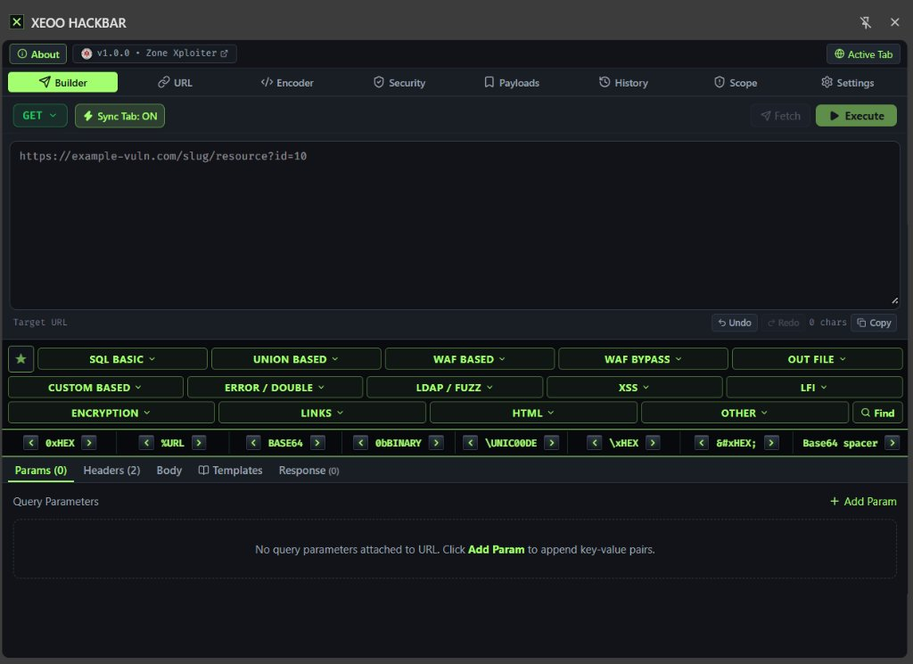

# XEOO HACKBAR

<p align="center">
  
</p>

<p align="center">
  <strong>Modern, Local-First Web Security Testing & HTTP Inspection Chrome Extension</strong><br>
  Built for authorized security assessments, bug bounty hunting, and web application auditing inside Google Chrome Side Panel.
</p>

<p align="center">
  
  
  
  
  
  
</p>

---

## Overview

**XEOO HACKBAR** is a high-performance, dark-themed browser extension for Google Chrome (Manifest V3) running directly in the browser's **Side Panel**. Inspired by classic penetration testing toolbars, it elevates the workflow into a secure, responsive, local-first platform featuring advanced request manipulation, extensive SQL/DIOS payload builders, live encoding suites, and defensive header security analysis.

---

## Key Features

### 1. HTTP Request Builder & URL Manipulator
- **Method Support**: `GET`, `POST`, `PUT`, `PATCH`, `DELETE`, `HEAD`, `OPTIONS`.
- **Active Tab Sync**: Instant synchronization with the currently open browser tab (`Sync Tab: ON/OFF`).
- **Precision URL Parser**: Disassembles Target URLs into protocol, hostname, port, path, query parameters, and hash with real-time bidirectional updates without character corruption.
- **Request Body Modes**: Raw text, JSON, and `application/x-www-form-urlencoded` key-value pairs.

### 2. Comprehensive Security Template Library (170+ Audited Payloads)
Structured across 14 top-level categories and dozens of subcategories:
- **SQL Basic**: Auth bypass, Boolean-based blind, Time-based blind, Stacked queries, SQL clauses, and comment vectors.
- **Union-Based & WAF-Based**: Full coverage for MySQL, PostgreSQL, and Microsoft SQL Server.
- **DIOS (Dump In One Shot)**:
  - 100% syntactically audited and verified templates.
  - Zero placeholder / unfinished slots.
  - Information schema, sys-schema, and InnoDB internal table catalog extractions.
  - Version comments (`/*!50000...*/`), inline comments (`/**/`), whitespace substitutions (`%0a`, `%09`, `%0c`, `%0d`), and URL hex variants.
- **Author Watermark & Custom Signature Modal**:
  - Dynamic author branding (`ZXMarchia`) injected into MySQL DIOS payloads.
  - Live hex generator with neon themes: **Neon Green Glow (`#A3FF70`)**, **Neon Red Fire (`#FF3344`)**, **Cyber Cyan (`#00FFFF`)**, **Electric Gold (`#FFE600`)**, and **ASCII Frame**.
- **Specialized Modules**: LFI/Path Traversal, XSS, LDAP/Fuzzing, Out-File, Custom Based, HTML containers, Defacement PoCs, and Links.

### 3. Quick Conversion Bar (Adaptive 3D Cyber Bevel)
- One-click text encoding and decoding directly on cursor selection or entire inputs:
  - `0xHEX` (Hex string literal)
  - `%URL` (Standard and full hex encoding)
  - `BASE64`
  - `0bBINARY` (8-bit binary)
  - `\UNIC00DE` (`\uXXXX` unicode escapes)
  - `\xHEX` (C-style hexadecimal)
  - `&#xHEX;` (HTML hex entities)
  - `Base64 spacer`
- **Dynamic Responsive Layout**: Uses `ResizeObserver` to seamlessly wrap into 2 balanced rows on standard viewports (< 780px) and 4 rows on narrow side panels (< 390px) without button clipping.

### 4. Payloads & Test Vector Repository
- Built-in library of 31+ real-world pentest vectors categorized across SQLi, XSS, LFI, RCE, SSRF, SSTI, XXE, and Open Redirects.
- Instant search filtering, tag queries, favorites toggle, and direct "+URL", "Set URL", and "+Body" actions.
- Full JSON export and import capabilities for custom wordlist backup.

### 5. Multi-Format Encoder / Decoder Suite
Dedicated interactive encoding workbench with simultaneous conversions:
- URL Decode / Encode (Component & RFC 3986 Full Hex)
- Base64 Encode / Decode
- Hex / ASCII conversions
- HTML Entities (Named & Numeric)
- MD5 & SHA-256 cryptographic hashing

### 6. Defensive Security & Response Inspector
- **Automated Security Header Analysis**: Grades response posture for CSP, HSTS, X-Frame-Options, X-Content-Type-Options, Referrer-Policy, and Permissions-Policy.
- **Information Leak & Technology Detection**: Alerts when `Server`, `X-Powered-By`, or debug headers leak software versions.
- **WAF Signature Detector**: Detects Cloudflare, ModSecurity, AWS WAF, and Akamai block signatures with direct advice.
- **Response Viewer**: Pretty, Raw, and Headers views with size, execution timing, and status tracking.

### 7. History, Evidence & Scope Guard
- **Encrypted Local Storage**: IndexedDB persistence (via Dexie v4) keeping all data 100% inside your browser.
- **Automatic Redaction**: Masking of authorization headers, session cookies, and API keys before saving logs.
- **Evidence Reporting**: One-click export to Markdown (`.md`) audit reports and JSON log bundles.
- **Scope Guardian**: Prevents accidental out-of-scope testing and blocks loopback/intranet requests by default.

---

## Tech Stack

| Component | Technology |
| :--- | :--- |
| **Extension Platform** | Google Chrome Desktop (Manifest V3 Side Panel API) |
| **Frontend Framework** | React 18.3 (Strict Mode) |
| **Language** | TypeScript 5.7 (Strict Type Checking) |
| **Styling** | Tailwind CSS v4 |
| **State Management** | Zustand v5 |
| **Local Database** | Dexie.js v4 (IndexedDB) |
| **Icons** | Lucide React |
| **Build Tooling** | Vite v6 |
| **Testing** | Vitest v3 |

---

## Installation & Setup

### Prerequisites
- [Node.js](https://nodejs.org/) >= 20
- [pnpm](https://pnpm.io/) (recommended) or `npm`

### Building from Source

```bash
# 1. Clone repository
git clone https://github.com/your-username/xeoo-hackbar.git
cd xeoo-hackbar

# 2. Install dependencies
pnpm install

# 3. Build production bundle
pnpm run build
```

The compiled extension files will be created in the `dist/` directory.

### Loading into Google Chrome

1. Open Google Chrome and visit `chrome://extensions/`.
2. Toggle **Developer mode** on (top right corner).
3. Click **Load unpacked**.
4. Select the `dist/` folder from this project directory.
5. Open the Side Panel in Chrome and select **XEOO HACKBAR** or click the extension toolbar icon.

---

## Verification & Testing

The project maintains 100% passing unit tests covering encoding algorithms, URL parsers, header analyzers, scope filters, and DIOS syntax integrity:

```bash
# Run all 69 unit tests
pnpm test
```

Audit validation criteria:
- **Parentheses Balance**: Verified on all 170+ subqueries.
- **Comment Delimiters**: 100% closed `/* ... */` comment pairs.
- **Hex Literals**: Compliant `0x...` formatting for MySQL lexers.
- **Cleanliness**: 0 undefined slots or draft placeholders.

---

## Architecture & Documentation

- [ARCHITECTURE.md](docs/ARCHITECTURE.md) — Comprehensive technical architecture and module specifications.
- [SECURITY.md](SECURITY.md) — Security policy, operational threat model, and vulnerability reporting.
- [PRIVACY.md](PRIVACY.md) — Local-first data handling and zero-telemetry policy.
- [DISCLAIMER.md](DISCLAIMER.md) — Legal terms of use and liability limitations.
- [CHANGELOG.md](CHANGELOG.md) — Version history and release notes.

---

## Disclaimer & Legal Notice

This software is developed strictly for **authorized penetration testing, CTF security competitions, web development debugging, and academic security research**. Testing web applications without prior mutual authorization is illegal under applicable cybercrime legislation. The authors and contributors assume zero liability for misuse. Refer to [DISCLAIMER.md](DISCLAIMER.md) and [SECURITY.md](SECURITY.md) for full terms.

---

## Author & Credits

- **Author**: Zone Xploiter / ZXMarchia
- **Project**: XEOO HACKBAR (v1.0.0)
- **License**: [MIT License](LICENSE)
